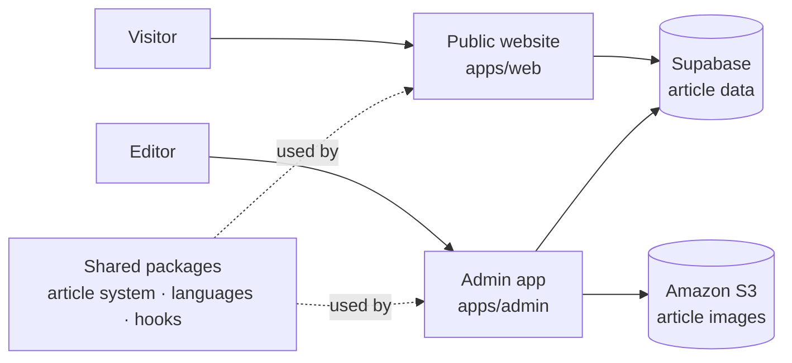

# Košice for You · Support Center

<p align="center">
  A multilingual information website with a protected admin app for managing news and events.
</p>

<p align="center">
  <a href="https://kosiceforyou.sk">Visit the live website ↗</a>
</p>

## About the project

I built this project for a working Foreigners' Support Center in Košice. The public website helps people find information about local services, organizations and the city. Staff can use the admin app to write and publish news and event articles without editing code.

The website supports Slovak, English and Ukrainian. It includes a home page with service and contact information, news and event pages, an immigrants map, and a partners page.

## Main features

| Public website | Admin app |
| --- | --- |
| Information about the center and its services | Sign-in for authorized staff |
| News and event listings and article pages | Create and edit news and events |
| Slovak, English and Ukrainian content | Edit article text in all three languages |
| Immigrants map and partner information | Add, crop and arrange article images |
| Responsive pages and language selection | Save drafts, publish, hide or delete articles |

## How the apps fit together

The public website and admin app have different jobs, so they are kept as separate applications. Shared article types and reusable code live in workspace packages.



### Public website — `apps/web`

The public app is built with React and TypeScript. It uses React Router for pages, i18next for interface translations, and Supabase to read article data. Article lists request published articles.

### Admin app — `apps/admin`

The admin app is built with Next.js and TypeScript. Staff sign in through Supabase. Admin pages and article-management requests check the signed-in user and the `admin` role in the `profiles` table.

The article editor supports separate titles and descriptions in Slovak, English and Ukrainian, a date and article type, rich-text editing, and image editing. Each article record stores its type, date, translated titles and descriptions, image URLs, and published status in Supabase. Uploaded images are converted to WebP in the browser and stored in Amazon S3.

### Shared packages — `packages/`

The workspace packages contain article types and components, language definitions, shared hooks, and fonts.

## Article workflow

1. An editor signs in to the admin app.
2. They create a news article or event, add its date and fill in the language versions.
3. They add and arrange images, then save the article as a draft or publish it.
4. Published articles are included in the public news and event lists. Editors can hide or delete articles from the admin app.

## Technology

| Area | Tools |
| --- | --- |
| Public website | React, TypeScript, React Router, i18next |
| Admin app | Next.js, React, TypeScript, TipTap |
| Sign-in and article data | Supabase Auth and Supabase database |
| Image storage | Amazon S3 |
| Shared code | npm workspaces and packages in `packages/` |

## Run locally

Use Node.js 20.9 or newer and npm. Install dependencies from the repository root:

```bash
npm install
```

Create local environment files for each app and add the values for your development environment. Do not put credential values in this README.

**`apps/web/.env`**

```text
REACT_APP_SUPABASE_URL=
REACT_APP_SUPABASE_ANON_KEY=
```

**`apps/admin/.env.local`**

```text
NEXT_PUBLIC_SUPABASE_URL=
NEXT_PUBLIC_SUPABASE_PUBLISHABLE_KEY=
AWS_REGION=
AWS_ACCESS_KEY_ID=
AWS_SECRET_ACCESS_KEY=
AWS_BUCKET_NAME=
```

Start an app from the repository root:

```bash
npm run web
```

```bash
npm run admin
```

The public app and admin app each use port `3000` by default. If you need to run both at the same time, start one of them on another port.

Build either app from the repository root:

```bash
npm run build:web
npm run build:admin
```

## Domain

The public website is available at [kosiceforyou.sk](https://kosiceforyou.sk). The repository's `vercel.json` includes a redirect from `kosice4you.sk` to `kosiceforyou.sk`.

## Project structure

```text
apps/
  web/                 Public React website
  admin/               Next.js admin app
packages/
  article-system/      Shared article types and UI
  assets/              Shared visual assets
  hooks/               Shared React hooks
  languages/           Language options and types
```
